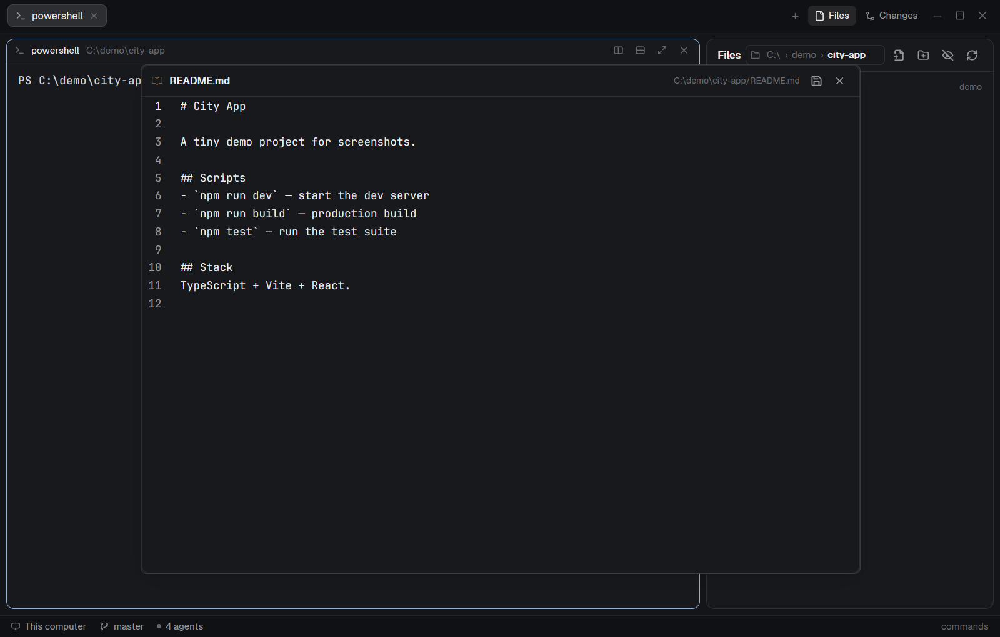
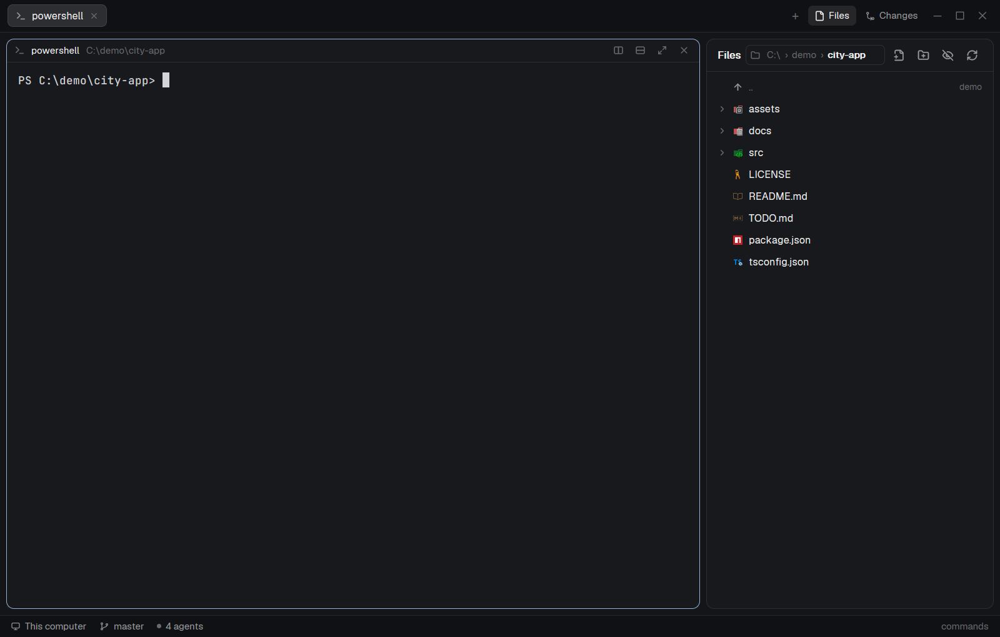

# herdr-files-plus

A file-manager upgrade pack for [Herdr](https://github.com/herdrdev/herdr-app): the
shipped `files` panel grown into a Netcatty-style file manager — breadcrumb
navigation, VS Code file icons, git marks, right-click file operations, drag-and-drop
upload, and remote files opened in floating editor windows — plus two bonus
clones (`pane-plus`, `status-plus`).



## What you get

- **files-plus** — the panel. Breadcrumb address bar (type a path, click
  ancestors, `..`), per-type file icons (vendored vscode-icons, folders
  included), git status letters on rows, show-hidden toggle, new
  file/folder, refresh. **Double-click a file** to open it in a draggable
  floating editor window — edit and save remote files directly (single
  click does nothing, folders still expand on click). **Drag files or
  folders in from the OS** to upload them into the browsed folder.
- **files-menu** — right-click menu on the tree: Open / Open terminal here /
  Download / Copy path / Move to parent / Move to… / Rename / Permissions /
  Delete / Refresh / New file / New folder / Upload file / Upload folder.
- **files-prompt** — the input and confirm dialogs the menu and panel open.
- **pane-plus** — shipped `pane` header + a focus-mode button: hides the
  sidebar/tabs/status/panel blocks and zooms the pane so the terminal fills
  the window; click again (or the `pane-plus.fullscreen` command) to restore.
- **status-plus** — shipped `workspace-status` bar + CPU / temperature / RAM
  segments for the active machine.



## Install

1. Copy the mods into your app home:

   ```sh
   # macOS / Linux
   cp -r mods/* ~/.config/herdr-app/mods/
   ```

   ```powershell
   # Windows
   Copy-Item -Recurse mods\* $env:USERPROFILE\.config\herdr-app\mods\
   ```

2. Copy `layouts/files-plus.json` to `~/.config/herdr-app/layouts/` and run
   `herdr-app do layout.switch --name files-plus` (or pick it from the layout
   switcher). It is the shipped `main` layout with `files` → `files-plus`,
   `pane` → `pane-plus`, `workspace-status` → `status-plus`. Prefer editing
   your own layout instead? Point its blocks at the three mod names.
3. Optional: merge `keys.json` into `~/.config/herdr-app/keys.json` to bind
   `alt-enter` → `pane-plus.fullscreen`.
4. `files-menu` and `files-prompt` need no layout entry — the panel opens
   them as overlays.

## Notes / caveats

- Remote writes and uploads go through the pane's terminal channel
  (`hc put` into the core files dir, then `mv`); on a machine with no
  terminal, small files (≤ ~60 KB) fall back to base64 appends.
- Editor windows cap editing at 400 KB of text (the read cap; larger files
  open read-only so a truncated buffer can't be written back).
- `pane-plus.fullscreen` / `pane-plus.unfullscreen` are mod commands; bind
  them in `keys.json` or run `herdr-app do pane-plus.fullscreen`.
- See [RECIPE.md](RECIPE.md) for the full behavior spec.

## License & credits

- New code: [MIT](LICENSE).
- The mods are built on Herdr's shipped `files` / `pane` /
  `workspace-status` / `menu` code — © herdr contributors,
  [Apache-2.0](LICENSE-APACHE).
- File icons are a subset of [vscode-icons](https://github.com/vscode-icons/vscode-icons)
  — © the vscode-icons contributors, [MIT](licenses/vscode-icons.LICENSE).
